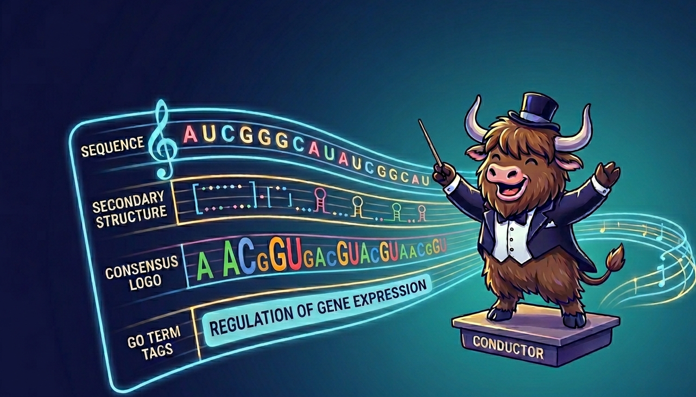

# yakRNA Design: A semantic multimodal RNA composer

<p align="center">
  
</p>

An RNA designer. Generate RNA sequences conditioned on nothing or a combination of secondary structure, consensus sequences, or gene ontology terms

**Paper**: [yakRNA Design: A semantic multimodal RNA composer](https://www.biorxiv.org/content/10.64898/2026.04.22.720245v1)

## Features

- **Conditional Generation**: Structure-guided and GO term-conditioned generation
- **Multiple Generation Modes**:
  - Unconditional (length-based)
  - Structure-conditioned (dot-bracket notation)
  - Consensus-conditioned
  - GO term-conditioned
  - Sequence infilling
- **Command-line interface**: Easy-to-use CLI for batch generation
- **Full training code**: the two-phase (MLM → discrete diffusion) trainer and
  the Rfam data pipeline that produced the released model — see [TRAINING.md](TRAINING.md)

## Try it in Colab

[](https://colab.research.google.com/github/YousufAKhan/yakRNA/blob/main/yakRNA_colab.ipynb)

No installation required — runs in your browser with free GPU access.

## Installation

### Option 1: Micromamba/Conda (Recommended)

```bash
git clone https://github.com/YousufAKhan/yakRNA.git
cd yakRNA

# macOS
micromamba env create -f environment-macos.yml

# Linux (with CUDA)
micromamba env create -f environment-linux.yml

micromamba activate yakrna
```

### Option 2: pip

```bash
git clone https://github.com/YousufAKhan/yakRNA.git
cd yakRNA

python -m venv venv
source venv/bin/activate

# pick the CUDA build that matches your driver (cu121, cu124, ...)
pip install torch --index-url https://download.pytorch.org/whl/cu121
pip install -r requirements.txt
```

## Quick Start

### Download Pre-trained Model

The model weights are hosted on Hugging Face. Download via the CLI:

```bash
pip install huggingface_hub
hf download MasterYster/yakRNA-Design yakRNA_110M.pt --local-dir checkpoints/
```

Or in Python:

```python
from huggingface_hub import hf_hub_download
hf_hub_download(repo_id="MasterYster/yakRNA-Design", filename="yakRNA_110M.pt", local_dir="checkpoints/")
```

Model page: https://huggingface.co/MasterYster/yakRNA-Design

### Generate Sequences

```bash
# Basic generation
python inference/rna_sequence_generator.py \
    --config configs/inference.yaml \
    --checkpoint checkpoints/yakRNA_110M.pt \
    --num_sequences 10 \
    --length 100
```

### Single Modality

```bash
# Unconditional (length-based)
python inference/rna_sequence_generator.py \
    --config configs/inference.yaml \
    --checkpoint checkpoints/yakRNA_110M.pt \
    --num_sequences 100 \
    --length 78 \
    --temperature 1.0 \
    --fasta_output random_sequences.fasta

# Secondary structure only
python inference/rna_sequence_generator.py \
    --config configs/inference.yaml \
    --checkpoint checkpoints/yakRNA_110M.pt \
    --num_sequences 100 \
    --secondary_structure ":::::::<<<<<<<<<---[[[[[-->>>>>>>>><<<<<<<<<<_________>>>->>>>>>>::::]]]]]::::" \
    --constraint_set canonical \
    --temperature 1.0 \
    --fasta_output ss_prompt.fasta

# GO term only
python inference/rna_sequence_generator.py \
    --config configs/inference.yaml \
    --checkpoint checkpoints/yakRNA_110M.pt \
    --num_sequences 100 \
    --go_terms "GO:0075523" \
    --length 78 \
    --temperature 1.0 \
    --fasta_output go_prompt.fasta
```

### Multimodal

```bash
# Structure + Consensus + GO terms
python inference/rna_sequence_generator.py \
    --config configs/inference.yaml \
    --checkpoint checkpoints/yakRNA_110M.pt \
    --num_sequences 100 \
    --consensus "GAGUaaGGGGuuCuAGU...gcaGCcCgcCUaGaaCCCUGcgacacuGGuucuaaaaCagAugucgUuuuaAGgGCuUUUG" \
    --go_terms "GO:0075523" \
    --secondary_structure ":::::::<<<<<<<<<-:::--[[[[[-->>>>>>>>><<<<<<<<<<_________>>>->>>>>>>::::]]]]]::::" \
    --constraint_set canonical \
    --temperature 1.0 \
    --fasta_output all_modalities.fasta
```

## Base-Pairing Constraints

When generating with secondary structure (`--secondary_structure`), base-pairing constraints are automatically applied using the `canonical` set by default. You can override this with `--constraint_set`:

| Constraint Set | Allowed Base Pairs | Description |
|----------------|-------------------|-------------|
| `strict` | A:U, U:A, G:C, C:G | Watson-Crick pairs only |
| `canonical` | A:U, U:A, G:C, C:G, G:U, U:G | Watson-Crick + wobble pairs |
| `canonical+sheared` | canonical + G:A, A:G | Adds sheared G:A pairs |
| `canonical+common` | canonical+sheared + A:C, C:A | Adds common non-canonical pairs |
| `permissive` | canonical+common + U:C, C:U | Most permissive set |

Example:
```bash
python inference/rna_sequence_generator.py \
    --config configs/inference.yaml \
    --checkpoint checkpoints/yakRNA_110M.pt \
    --secondary_structure "((((....))))" \
    --constraint_set canonical \
    --num_sequences 5
```

## Project Structure

```
yakRNA/
├── inference/
│   ├── rna_sequence_generator.py   # Main generation script
│   └── discrete_diffusion.py       # Diffusion components (shared with training)
├── rna_gen/
│   ├── rna_gen_training.py         # Two-phase trainer (MLM → discrete diffusion)
│   └── metrics_calculator.py       # Per-modality / per-timestep metrics
├── data_processing/
│   ├── download_rfam.py            # Fetch Rfam and build per-family alignments
│   ├── rfam_data_preprocessing.py  # Alignments → tokenizable HDF5
│   ├── vocabulary.py               # Build the unified multimodal vocabulary
│   └── training_data_preparation.py# Datasets, family-diverse samplers, masking
├── configs/
│   ├── inference.yaml              # Generation config
│   ├── train_110M.yaml             # The released model's exact training recipe
│   ├── train_single_gpu.yaml       # Same recipe sized for one GPU
│   └── train_smoke.yaml            # Tiny end-to-end pipeline check
├── environment/
│   └── train_cluster.slurm         # 8-GPU Slurm example
├── training_data/processed/vocabulary_analysis/
│   └── unified_vocabulary.json     # Vocabulary used by the released model
├── environment-macos.yml
├── environment-linux.yml
├── requirements.txt
├── requirements-training.txt
├── TRAINING.md                     # Data pipeline + training guide
└── README.md
```

## Training

The complete training pipeline is included: Rfam download, tokenization, the
two-phase objective, multi-GPU launch, and resuming or fine-tuning from the
released checkpoint. [**TRAINING.md**](TRAINING.md) is the full guide; the short
version is:

From a fresh clone to a training run, with the prebuilt dataset:

```bash
# 1. training extras (wandb is optional - see TRAINING.md)
pip install -r requirements-training.txt

# 2. data: download semRfam, the tokenized dataset the released model was
#    trained on (~2.3 GB) into training_data/processed/
python data_processing/download_rfam.py --stage prebuilt

# 3. train
python rna_gen/rna_gen_training.py --config configs/train_single_gpu.yaml
# or, the released 110M recipe on 8 GPUs:
torchrun --nproc_per_node=8 rna_gen/rna_gen_training.py --config configs/train_110M.yaml
```

Prefer to build the dataset from Rfam yourself instead of downloading it:

```bash
python data_processing/download_rfam.py --stage seed-all   # 93k sequences, ~1 min
# (--stage full-all rebuilds the ~4M-sequence set; needs Infernal and hours)
python data_processing/rfam_data_preprocessing.py --stage all
python data_processing/training_data_preparation.py \
    --config configs/train_single_gpu.yaml --create-lookup
```

To check the whole pipeline first (~2 min, tiny model, no W&B account needed):

```bash
python rna_gen/rna_gen_training.py --config configs/train_smoke.yaml
```

Dataset page: https://huggingface.co/datasets/MasterYster/semRfam — 3,978,586
sequences across 4,028 Rfam families, with the exact family-level split used for
the released model.

Checkpoints land in `training.output_dir` and are directly loadable by
`inference/rna_sequence_generator.py`. `configs/train_110M.yaml` is the exact
configuration the released checkpoint was trained with, recovered from the
checkpoint itself.

**Note on the vocabulary:** `training_data/processed/vocabulary_analysis/unified_vocabulary.json`
is the vocabulary the released model uses. Keep it when fine-tuning or resuming
from `yakRNA_110M.pt`; rebuilding it from your own data assigns different token
ids and makes that checkpoint incompatible.

## System Requirements

- **OS**: Linux or macOS
- **GPU**: NVIDIA GPU with CUDA support (recommended)
- **RAM**: 16GB+
- **Python**: 3.10

For training: a 24GB GPU trains the 110M architecture at batch 16; the released
model used 8 GPUs for 50,000 steps. Rebuilding the full Rfam dataset needs
~20GB of disk and Infernal (`cmalign`).

## License

MIT License - see [LICENSE](LICENSE)

## Citation

If you use yakRNA in your research, please cite:

```bibtex
@article{pinpin2026yakrna,
  author = {Pinpin, Louie Nathaniel and Khan, Yousuf A.},
  title = {yakRNA Design: A semantic multimodal RNA composer},
  journal = {bioRxiv},
  year = {2026},
  doi = {10.64898/2026.04.22.720245},
  url = {https://doi.org/10.64898/2026.04.22.720245},
  note = {Preprint}
}
```

## Contact

- **Author**: Yousuf Khan
- **GitHub**: [@YousufAKhan](https://github.com/YousufAKhan)
